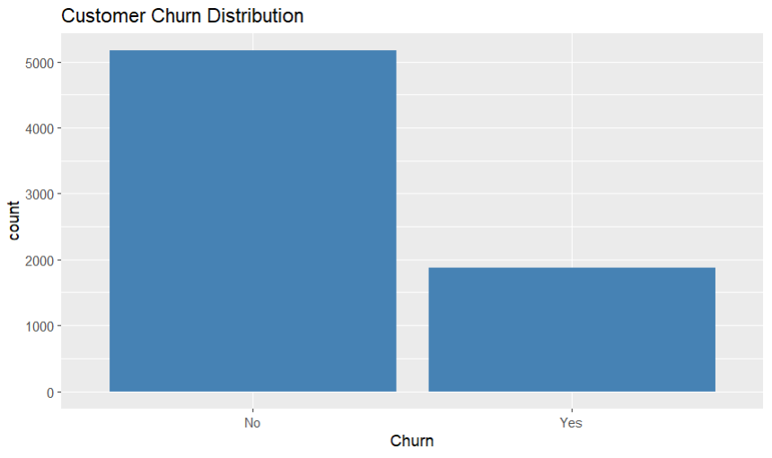
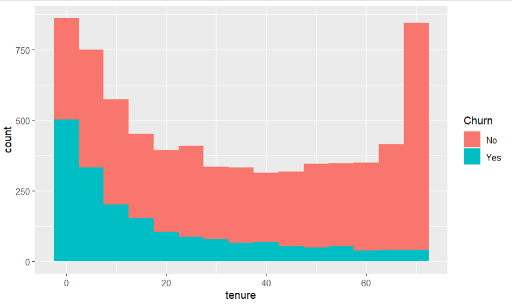

📊 Telecom Customer Churn Analysis and Prediction

📌 Project Overview
This project focuses on analyzing telecom customer data and predicting customer churn using **R Programming and Logistic Regression**.

Customer churn occurs when customers discontinue their telecom services. This project uses data analytics and machine learning techniques to identify customer churn patterns and predict potential customer departures.

🎯 Objectives
- Analyze telecom customer churn patterns.
- Perform data cleaning and preprocessing.
- Conduct Exploratory Data Analysis (EDA).
- Visualize customer behavior using ggplot2.
- Build a Logistic Regression model.
- Evaluate model performance using a confusion matrix.

🛠️ Technologies Used
- R Programming
- tidyverse
- ggplot2
- caret
- Logistic Regression

📂 Dataset
**Telco Customer Churn Dataset**

- Total Records: 7,043 customers.
- Target Variable: Churn (Yes/No).
- Features include tenure, monthly charges, contract type, and customer services.

Dataset Source: [Kaggle – Telco Customer Churn](https://www.kaggle.com/datasets/blastchar/telco-customer-churn)

⚙️ Project Workflow
1. Data Collection
2. Data Preprocessing
3. Exploratory Data Analysis
4. Data Visualization
5. Train-Test Splitting (70:30)
6. Logistic Regression Model Building
7. Customer Churn Prediction
8. Model Evaluation

📈 Key Insights
- Customers with shorter tenure are more likely to churn.
- Higher monthly charges are associated with increased churn.
- Month-to-month contract customers show higher churn rates.
- Long-term customers demonstrate stronger retention.

📊 Visualizations
- Customer Churn Distribution
- Tenure vs Customer Churn

🔮 Future Enhancements
- Implement Random Forest and Support Vector Machine models.
- Improve prediction performance through hyperparameter tuning.
- Develop interactive dashboards using R Shiny.
- Apply cross-validation techniques.

👨‍💻 Author
**G Shashidhar**

Computer Science and Engineering  
Vardhaman College of Engineering, Hyderabad

⭐ Project Type
Data Analytics | Machine Learning | R Programming

📊 Project Visualizations

1. Customer Churn Distribution

This graph shows the distribution of customers who stayed and customers who left the telecom service.

2. Tenure vs Customer Churn

This graph illustrates the relationship between customer tenure and churn behavior.

📈 Model Performance

| Evaluation Metric | Result |
|---|---:|
| Accuracy | 78.98% |
| Sensitivity | 89.82% |
| Specificity | 48.93% |
| Kappa | 0.418 |

---

*Developed as part of the Data Analytics Course End Project.*
